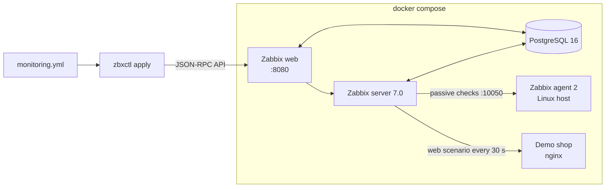

# homelab-monitoring

[](https://github.com/taharabs/homelab-monitoring/actions/workflows/ci.yml)


**Zabbix monitoring as code, with an outage drill that runs on every commit.**

A complete Zabbix 7.0 LTS lab in one `docker compose up`, plus `zbxctl`, a small tool that reads what should be monitored from a YAML file and applies it through the Zabbix API. Hosts, templates, website checks and alert triggers live in Git, get reviewed like code, and can be rebuilt on a fresh server in seconds instead of clicking through the web interface.

Every push runs a drill in CI: start the lab, apply the configuration, wait for real data from the agent, **stop the demo website, check that Zabbix raises the alert, restart it and check that the alert clears.**

<!-- SCREENSHOT -->

## What is in the lab



| Service | Image | Role |
| --- | --- | --- |
| `postgres` | `postgres:16-alpine` | Zabbix database |
| `zabbix-server` | `zabbix/zabbix-server-pgsql:alpine-7.0-latest` | Collects data, evaluates triggers |
| `zabbix-web` | `zabbix/zabbix-web-nginx-pgsql:alpine-7.0-latest` | Web interface and API on port 8080 |
| `zabbix-agent` | `zabbix/zabbix-agent2:alpine-7.0-latest` | A Linux machine to monitor (CPU, memory, disks, network) |
| `shop-web` | `nginx:1.27-alpine` | A website to check from the outside |

## Quick start

```bash
git clone https://github.com/taharabs/homelab-monitoring.git
cd homelab-monitoring
docker compose up -d                 # first start takes about a minute

python -m venv .venv && source .venv/bin/activate
pip install -e .
zbxctl wait                          # until the API answers
zbxctl apply --dry-run               # see what would change
zbxctl apply                         # make it so
zbxctl status                        # host availability and open problems
```

Open <http://localhost:8080> (user `Admin`, password `zabbix`; change it in a real setup). Within a minute the agent's graphs fill in. Then try the drill yourself:

```bash
docker compose stop shop-web         # about 30 seconds later: "Shop home page is down" (High)
docker compose start shop-web        # the problem resolves
```

## The monitoring file

```yaml
host_groups:
  - Homelab/Linux servers
  - Homelab/Web services

hosts:
  - host: zabbix-agent
    name: Linux server (agent 2)
    groups: [Homelab/Linux servers]
    templates: [Linux by Zabbix agent]
    interface: { dns: zabbix-agent, port: 10050 }
    tags: { env: homelab, role: linux }

  - host: shop-web
    name: Demo shop website
    groups: [Homelab/Web services]
    web_checks:
      - name: Shop home page
        url: http://shop-web/
        expect_status: 200
        expect_text: Demo shop       # the page must contain this text
        interval: 30s
        severity: high               # info, warning, average, high, disaster
```

Each web check becomes a Zabbix web scenario and a trigger named `<check name> is down`, on the expression `last(/<host>/web.test.fail[<check name>])<>0`.

## How `zbxctl apply` behaves

- **Idempotent.** A second run right after the first makes no change and says so.
- **Additive and safe.** It creates what is missing, adds missing groups and templates to existing hosts, and updates web checks and triggers that drifted from the file. It never deletes, so anything created by hand in the web interface stays.
- **Checked before writing.** The file is validated first (unknown groups, bad intervals, unsafe names), and a template that does not exist in Zabbix stops the run before any change.
- **Dry run.** `--dry-run` lists the changes and makes none: useful in a pull request.
- **No secrets in the file.** Connection settings come from `ZABBIX_URL`, and either `ZABBIX_TOKEN` (an API token, recommended) or `ZABBIX_USER` / `ZABBIX_PASSWORD`.

```text
$ zbxctl apply
Applied 6 change(s):
   create_group       Homelab/Linux servers
   create_group       Homelab/Web services
   create_host        zabbix-agent  (Linux by Zabbix agent)
   create_host        shop-web  (no template)
   create_web_check   shop-web: Shop home page  (http://shop-web/ every 30s)
   create_trigger     shop-web: Shop home page  (Shop home page is down, high)

$ zbxctl apply
No changes: Zabbix already matches monitoring.yml
```

`zbxctl status --fail-on high` exits with code 2 when a problem of that severity or worse is open, so it can gate a deployment script.

## Tests

| Suite | What it proves | Where |
| --- | --- | --- |
| Unit (24 tests) | Config validation, create / no-op / drift correction / dry run, API errors, CLI, against an in-memory imitation of the Zabbix 7.0 API | `tests/test_zbxctl.py`, about a second |
| End to end | On the real Compose lab: apply twice (second run changes nothing), agent data arrives, website outage raises then clears the High problem | `tests/test_integration.py`, in CI on every push |

```bash
python -m pytest                                   # unit tests
ZABBIX_URL=http://localhost:8080 python -m pytest -m integration -v -s   # with the lab running
```

## Why I built it

I administer servers and networks day to day (PRTG today, Zabbix as the next step). Configuring monitoring by clicking works for five hosts and fails quietly at fifty: nobody knows who changed a threshold, and rebuilding a server means redoing everything by hand. This lab is how I learn Zabbix properly and how I would run it at work: configuration in Git, changes reviewed, and a test that proves an outage really pages someone.

## Roadmap

- [ ] Alert actions: e-mail and a webhook to a chat channel when a High problem opens
- [ ] Windows host with the `Windows by Zabbix agent` template
- [ ] SNMP checks for a switch and a printer
- [ ] Grafana dashboard on the Zabbix data source
- [ ] Custom item that runs [it-automation-toolkit](https://github.com/taharabs/it-automation-toolkit)'s daily health check and alerts on its exit code

## License

MIT. Built by [Mohamed Tahar Ababsa](https://github.com/taharabs).
